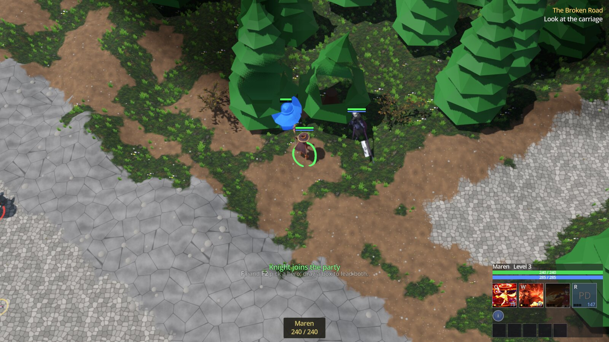
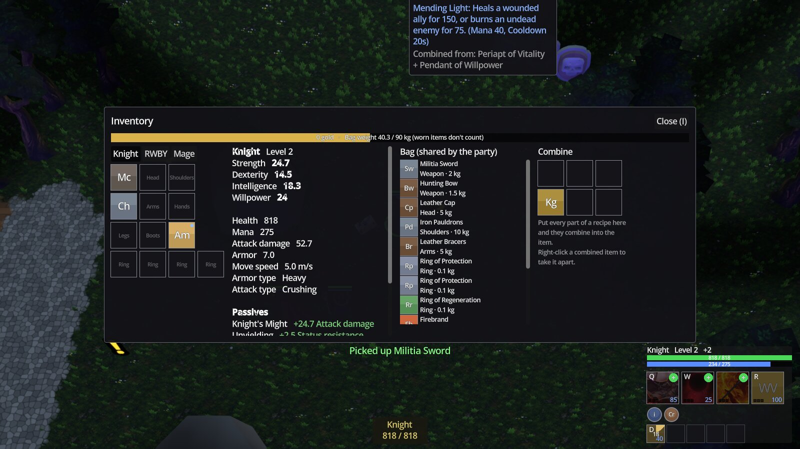
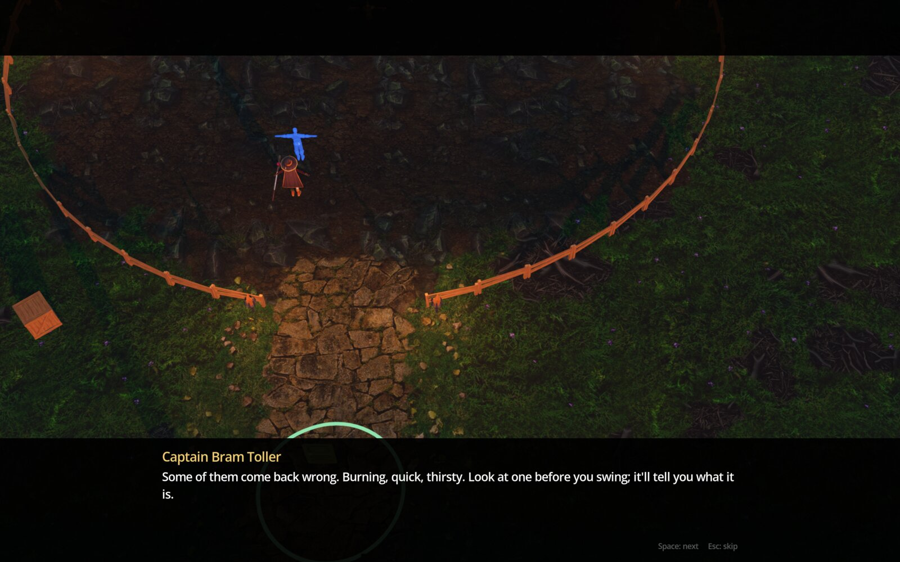
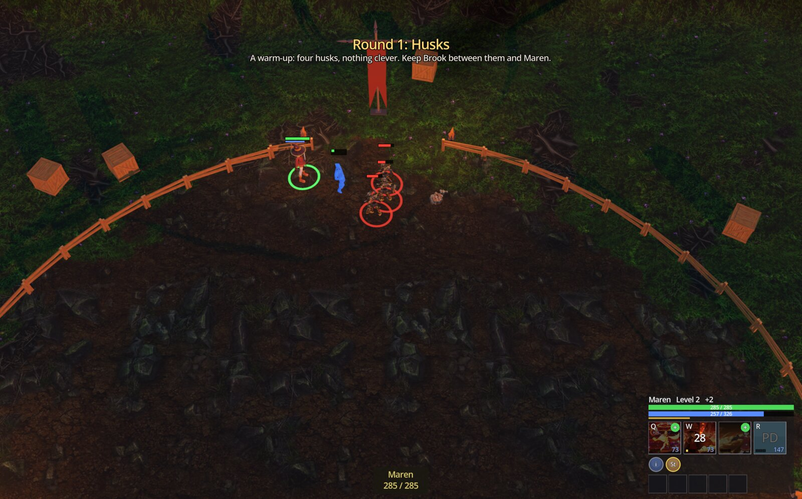
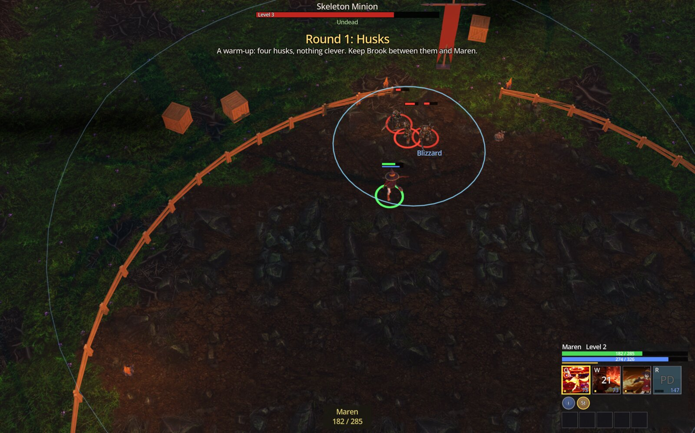
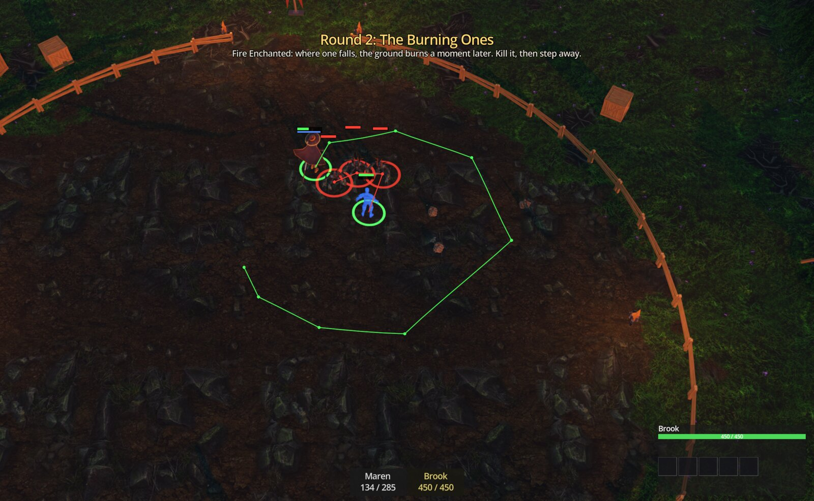
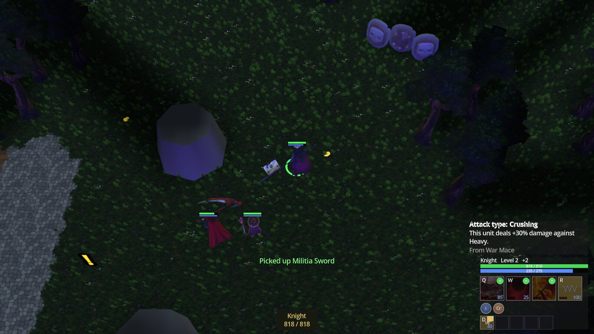

# New Stranger

An action RPG with real-time-strategy hands, built in Godot 4.7 (GDScript), with the
unit simulation's core written in Zig: party-based combat (selection, orders,
formations, spells aimed on the ground) with the loot, pace and map scale of an
action RPG.

> **This repository is code only.** It holds the scripts, shaders, native core,
> editor plugins, tools and tests. Scenes, resources, models, textures and audio
> are not included, so the game does not open or run from this checkout alone.

## Gameplay features

- **A party of up to three heroes**, each with its own kit of ground-aimed spells
  that scale with a different stat per class and hit crowds rather than single
  targets (area frost, a crowd-control pulse, a cleaving rage, a projectile that
  pierces a line of enemies).
- **Four core stats** (Strength, Dexterity, Intelligence, Willpower), each feeding
  a handful of small, single-effect class passives. Attack and armor types add
  damage bonuses without ever imposing penalties.

- **Randomized and named loot.** Items are bases with an item level and a rarity:
  common, magic (one or two affixes), rare (three or four), and legendary (a
  fixed name plus a scripted power that changes how a spell works). Named parts
  drop from particular enemies and combine in a grid into named items, keeping
  their rolled stats. The whole party shares one bag limited by weight, not by
  item shapes.
- **A level curve and champions.** Every map has a monster level, and champions
  carry one to three modifiers (extra strong, extra fast, vampiric, fire
  enchanted...), shown in an enemy panel on hover and a card on click.
- **An arena**: rounds of champions and modifiers for gold, each round harder
  than the last, with each enemy's card explaining what it does before you
  engage it.

- **An overnight economy.** Resting at an inn costs gold and grants a small,
  timed buff from a meal; earning that gold is the game outside the fighting.
- **Procedurally arranged maps.** Each map is a graph of places along a winding
  main road with branches, filled in by a seeded generator from hand-made
  pieces (woods, ruins, farms, camps, shrines, guarded caches) by density
  rules. Several layouts of each map are pre-generated, and a new game picks
  one at random.

## How it is built

- **Unit registry in Zig** (`native/`): one structure-of-arrays store per unit kind,
  handles that carry their kind, living and fallen rows kept apart, the walkable
  grid, target scans and the fog of war's sight casting. About 400 simulated
  creeps run at a 30 Hz game clock decoupled from the frame rate, with navigation
  queries on worker threads. It has no engine dependency, so it can be tested
  headless (`zig build test`).
- **Game clock** (`scripts/rts/simulation.gd`): rules run in ordered phases off
  the physics step, so they cost the same at any frame rate.
- **Fog of war** with height occlusion, per-team vision maps and hidden-unit
  filtering, so stealth works through it.
- **Saves** are plain data (no objects): a header plus a full world snapshot,
  written whole or not at all, with a crash-recovery slot. The same data is meant
  to carry multiplayer, where the host is the server and clients send orders.
- **Quests as nodes**: quests, steps, triggers, story scenes, gates, a time-of-day
  node, innkeepers and vendors are scene nodes configured in the editor.
- **Developer console** in debug builds (`` ` ``): commands for gold, levels,
  spawning, teleporting, quest steps, flags, time of day, and presets.
- **Editor tooling** (`addons/`): terrain brushes, heightmap import and export,
  tileset painting, map props and markers, and a Tests dock.

## Tests

`tests/` holds scripted tests that play parts of the game by themselves (spells,
quests, saves, the tutorial, the generated maps' reachability, a story linter),
a runner (`tests/run_tests.sh`, 16x game speed by default) and a recorder that
turns a played session into a replayable test. Some of the screenshots above were
taken by the test suite; the arena shots are from a played session.

## Layout

| Path | What |
|---|---|
| `scripts/` | game rules and UI (GDScript) |
| `shaders/` | terrain, cliffs, particles, fog, see-through |
| `native/` | the unit registry's core (Zig, built as a GDExtension) |
| `addons/` | editor plugins |
| `tools/` | map and story generators, asset converters, preset extractor |
| `tests/` | tests, runner, recorder |

Build the native core: `cd native && zig build -Doptimize=ReleaseFast`.

## Attribution

The `tools/noh/` scripts read game data from **NoH** (Newerth of Heroes,
https://github.com/shawwn/noh) by Shawn Presser and contributors, an open-source
reimplementation of an RTS engine. Parts of this project's registry, lane and
spell rules are ported from it and from community RTS maps. No game data or art
from them is included here, and the converters need a copy of NoH's game folder
you have the right to use.
